# Customer Support Ticket Priority Prediction and Automated Assignment System using Agentforce

A Salesforce project that stores customer support tickets, sets their priority (High, Medium or Low) from the description, creates a Task for urgent tickets, and lets an Agentforce agent run the check from a short chat.

Built and tested in a Salesforce Developer Edition org as part of the Skillwallet Salesforce Administrator with Agentforce program.

**Author:** Rohan Verma
**Demo video:** [Watch on Google Drive](https://drive.google.com/file/d/1Kq9VWCUSgfVx2gRYQOVapVc3nXvSOQcj/view?usp=sharing)

## Problem

Support teams get many tickets, and someone has to read each one to decide which to handle first. This is slow, and different people decide differently, so an urgent ticket can wait in the queue. This project does that first check automatically.

## What I built

- **Custom object** `Support Ticket Intelligence` with fields for customer, contact, issue type, description, priority, status, assigned user, SLA risk and resolution time
- **Auto-launched Flow** that finds an account, takes its newest ticket and sets the priority from keywords in the description
- **Agentforce agent** with a subagent `Support Ticket Priority Analysis` and an action that runs the Flow
- **Reports and dashboard**: Tickets by Priority Level (donut) and Tickets by Status (funnel)
- **Lightning App** with the ticket object, Reports and Dashboards
- **Sample data** loaded with the Data Import Wizard

## How the Flow decides the priority

| Description contains | Priority | What happens |
|---|---|---|
| urgent, not working, failure | High | A Task "Urgent Ticket Handling" is created and the assigned agent is set to Senior Support Agent |
| issue, slow, delay | Medium | Message says it will be handled shortly |
| anything else | Low | Message says it is queued for processing |

High is checked before Medium, so a ticket like "urgent issue" is not marked Medium.

The Flow takes the account name as input and returns the account Id, ticket Id, priority level, assigned agent and an action message.

## Testing

I tested the agent in Conversation Preview with three accounts. Each account's newest ticket was a known case.

| Account | Newest ticket | Expected | Result |
|---|---|---|---|
| ABC | Urgent payment failure | High | High, Task created |
| XYZ | Dashboard is slow to load | Medium | Medium |
| Nova | General query about plans | Low | Low |

There are 23 tickets in total (20 imported and 3 added by hand): 8 High, 8 Medium and 7 Low.

## Problems I ran into

- The import failed because of the date format, so I removed the optional Created Date column.
- Some rows failed because the Status picklist value was `Resolve` and my file had `Resolved`. I corrected the picklist value.
- Every ticket was marked Low because the Medium outcome needed all keywords together. I changed it to match any keyword.
- The Task was not created for High tickets until I turned on activities for the custom object.
- The Data Import Wizard cannot map the Customer lookup, so I set the customer on the tickets after the import.

## Screenshots

| | |
|---|---|
| 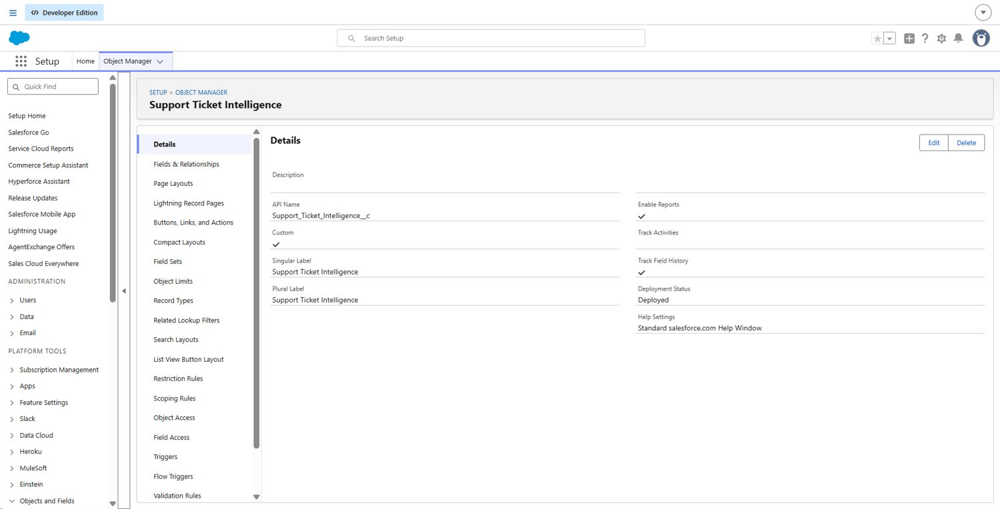 | 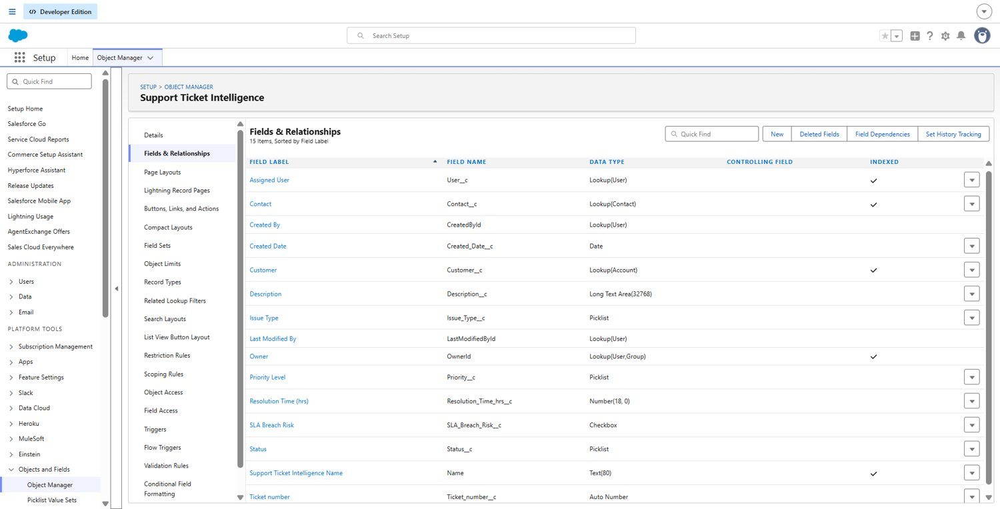 |
| 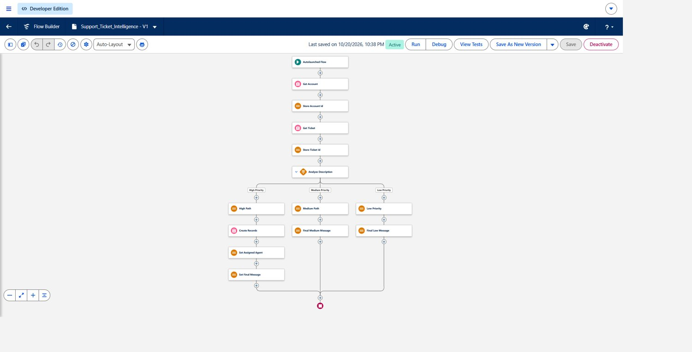 | 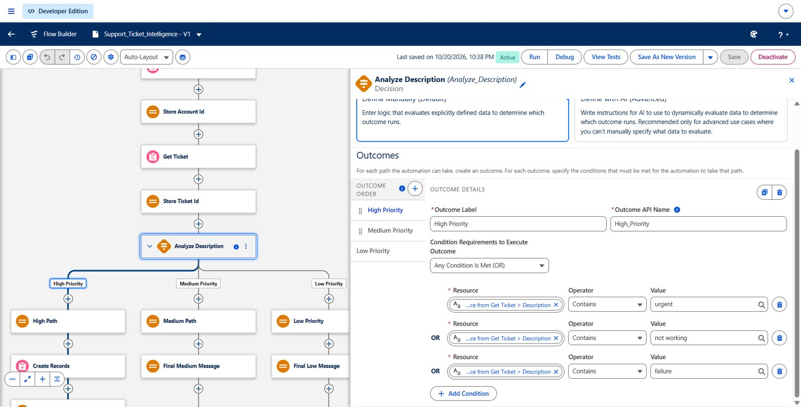 |
| 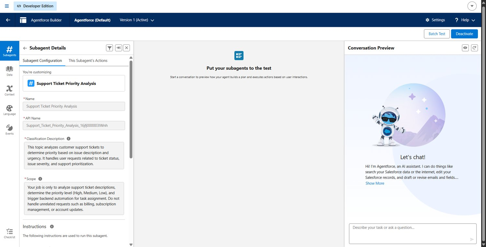 | 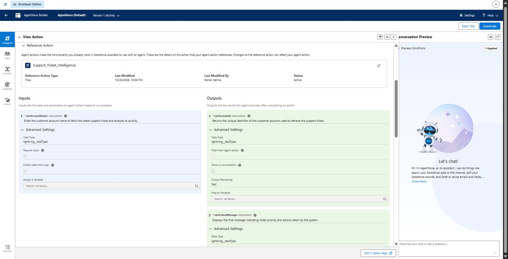 |
| 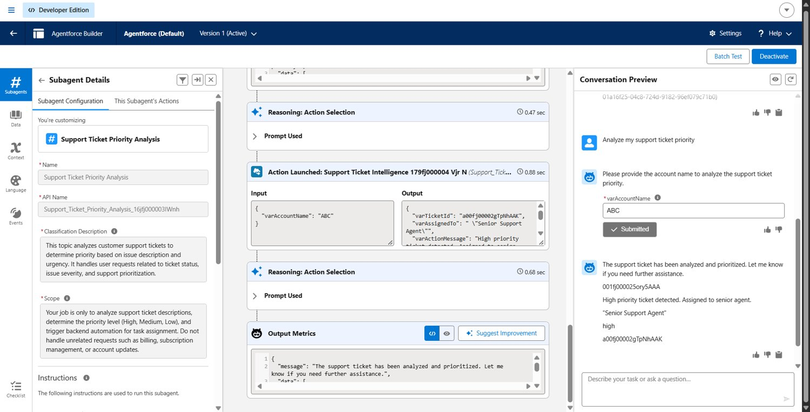 | 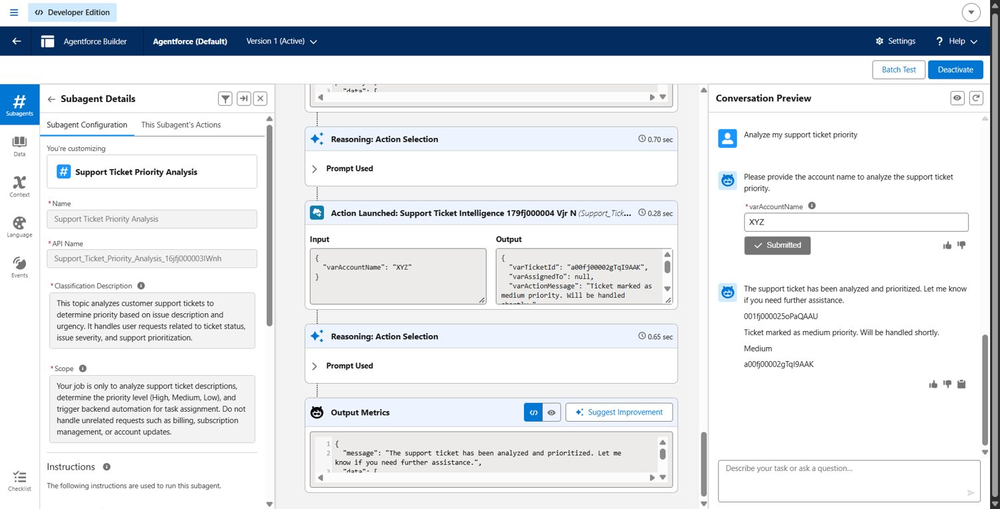 |
| 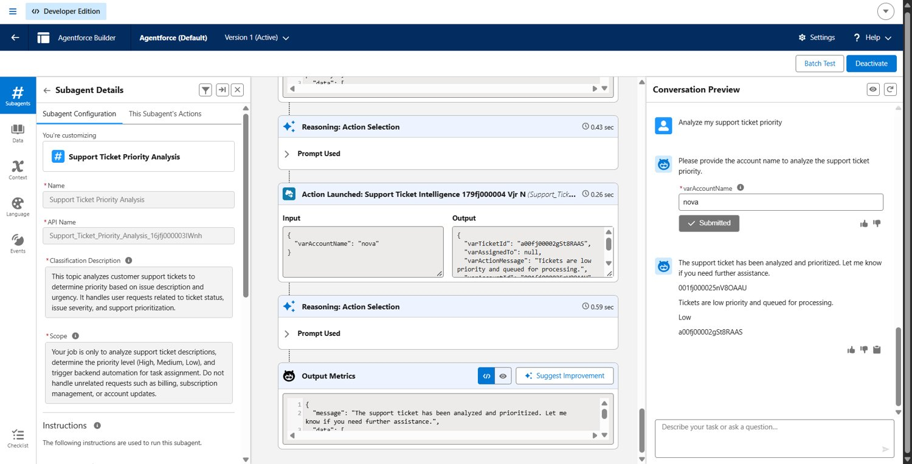 | 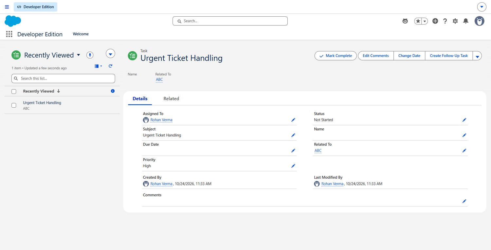 |
| 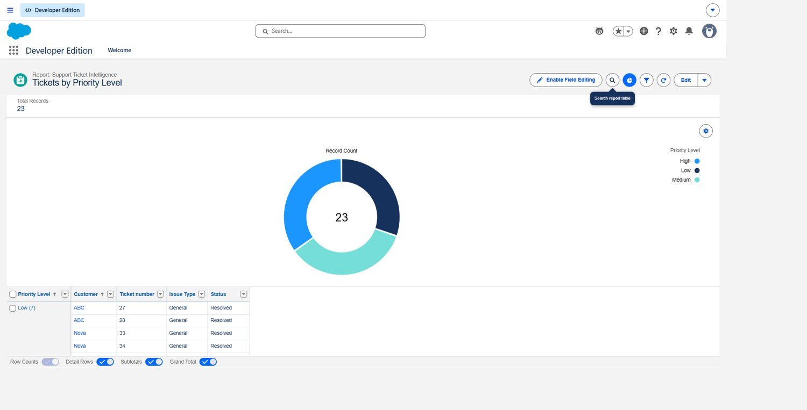 | 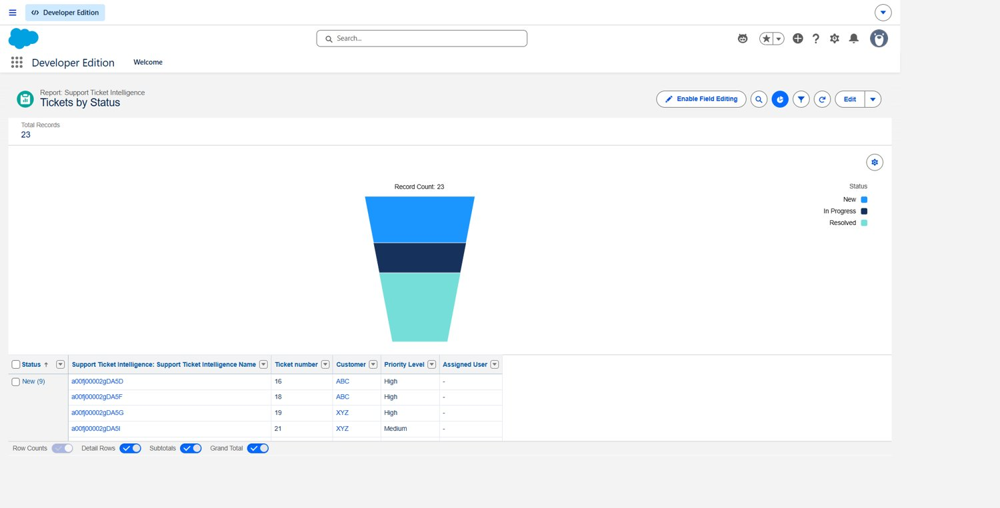 |
| 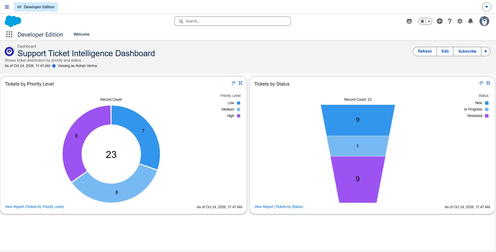 | 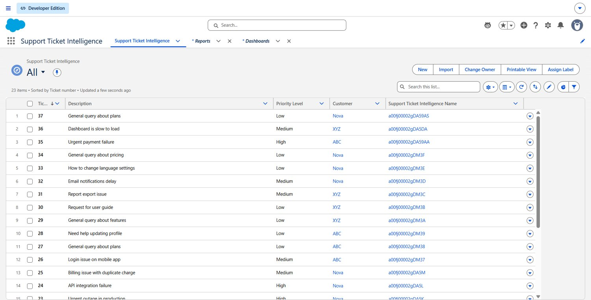 |

All screenshots are in the `screenshots` folder.

## Limits

- The priority is based on keywords, not machine learning, so unusual wording can be marked wrongly.
- Only the newest ticket of an account is checked.
- The assigned agent is a text label, not a real user.
- Built in a Developer Edition org and not deployed to production, because a Developer org has no linked production org.
- No validation rules or approval process were created.

## Future work

- A chatbot for raising and checking tickets
- AI-based priority suggestions instead of fixed keywords
- Assigning tickets to real users by workload
- Writing the priority back to the ticket record
- Validation rules and an approval step for closing High tickets
- SLA timers and escalation
- Deployment to production through a sandbox

## Repository contents

```
docs/          Project documentation (Word)
data/          tickets.csv, all 23 sample tickets
screenshots/   Screenshots of each part of the build
README.md      This file
```

`data/tickets.csv` lists all 23 tickets. The first 20 were imported with the Data Import Wizard, and the last 3 (one for each account) were added by hand so that the newest ticket of ABC, XYZ and Nova was a known High, Medium and Low case. The file has a Customer column for reference. The Data Import Wizard cannot map the Customer lookup, so leave that column unmapped and set the customer on the tickets after the import.
